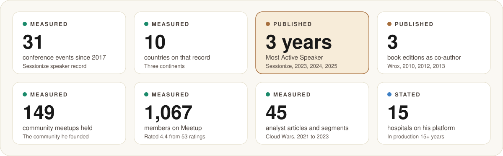
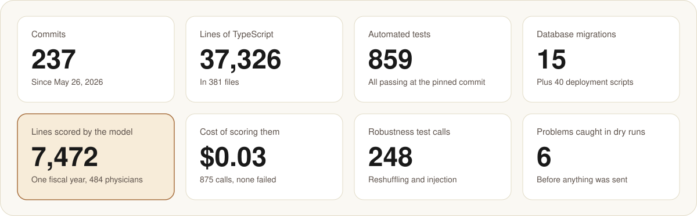
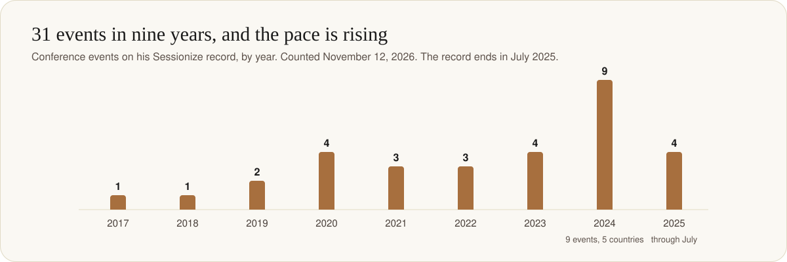

  

  <a href="../README.md"><b>Back to the class</b></a> &nbsp;·&nbsp;
  <a href="#the-record-in-eight-numbers"><b>The record</b></a> &nbsp;·&nbsp;
  <a href="#why-this-class-is-his-to-teach"><b>Why this class</b></a> &nbsp;·&nbsp;
  <a href="#on-stage"><b>On stage</b></a> &nbsp;·&nbsp;
  <a href="#what-he-builds"><b>What he builds</b></a> &nbsp;·&nbsp;
  <a href="#book-him"><b>Book him</b></a>

 

<table>
<tr>
<td width="150" align="center">
  
</td>
<td>

**Paul J. Swider** builds AI that hospitals run in production, and then
teaches how it was done. He is the founder, CEO and Chief AI Officer of
[RealActivity](https://www.realactivity.ai), a Microsoft partner that
delivers governed AI for academic medical centers. He is a co-author of three
editions of Wrox's *Professional SharePoint Development*, the creator of the
open-source health agent [Tula](https://github.com/realactivity/tula), and
the founder of the Boston Healthcare Cloud & AI Community.

</td>
</tr>
</table>

> [!NOTE]
> **How to read this page.** This class teaches one habit above all: ask
> where a number came from. So every number here carries one of three labels.
>
> - **Measured**: counted by us on a public platform or in the project's
>   repository on November 12, 2026.
> - **Published**: on the record of a third party, such as a publisher or a
>   platform's own award.
> - **Stated**: said by Paul or his company, and not independently checked.
>
> It is the speaker bio held to the standard of the class.

## The record in eight numbers

  

| Number | What it is | Label | Source |
| --- | --- | --- | --- |
| 31 | Conference events, October 2017 to July 2025 | Measured | [Sessionize](https://sessionize.com/pswider) |
| 10 | Countries on that record: United States, Mexico, Philippines, Malaysia, South Korea, India, Singapore, United Kingdom, France, Czechia | Measured | [Sessionize](https://sessionize.com/pswider) |
| 3 years | Sessionize "Most Active Speaker", 2023, 2024 and 2025 | Published | [Sessionize](https://sessionize.com/pswider) |
| 3 | Book editions as co-author, 2010, 2012 and 2013 | Published | Wrox; see [Writing](#writing) |
| 149 | Meetups held by the community he founded | Measured | [Meetup](https://www.meetup.com/healthcare-tech-community) |
| 1,067 | Members of that community on Meetup, rated 4.4 from 53 ratings | Measured | [Meetup](https://www.meetup.com/healthcare-tech-community) |
| 45 | Bylined analyst articles and segments, November 2021 to May 2023 | Measured | [Cloud Wars](https://cloudwars.com/author/paul-swider/) |
| 15 | Hospitals of one academic health system running his platform, for 15+ years | Stated | [RealActivity](https://www.realactivity.ai) |

## Why this class is his to teach

Most talks about a new kind of model are given by people who read the
announcement. This one is given by someone who put the model in front of a
year of real hospital data, measured what it did, and wrote down what went
wrong.

  

All eight are **measured**, from the project's repository and run logs.

- **He ships the system he teaches from.** Provider Activity Studio is 37,326
  lines of TypeScript with 859 automated tests, built in 237 commits since
  May 26, 2026.
- **He builds the way he says teams should.** 125 of those commits are his
  own and 112 were authored by AI coding agents he directed. That is the working method his recent talks describe, practised on
  a production codebase.
- **He ran the experiment, on real data.** 7,472 lines of physician time for 484
  physicians, one fiscal year, scored by a decision model. Three runs, 875
  calls, three cents, and no failed call.
- **He caught the problems before they mattered.** Six issues surfaced in dry
  runs, with a keyword mock standing in for the model, before a single line
  left the building. [The class tells all six](../README.md#8-what-went-wrong-and-what-it-taught).
- **He published the result that cuts against his own system.** 248 extra
  calls showed that a sentence typed into a description can flip the model's
  reading from 98 percent one way to 83 percent the other. It is in the class
  materials, with the note that nothing in the pipeline detects it yet.

That last point is the reason to trust the rest.

## On stage

  

**Measured** from his [Sessionize record](https://sessionize.com/pswider).

- **2024 was his busiest year on record:** nine events in five countries, the
  United States, the Philippines, Malaysia, South Korea and India.
- **Asia, three Octobers running.** Kuala Lumpur and Singapore in 2022;
  Manila, Singapore and Kuala Lumpur in 2023; Manila, Kuala Lumpur and Seoul
  in 2024.
- **A home crowd too.** Boston Code Camp, the AI Community Conference in
  Cambridge, and M365 Community Days in New York in both 2024 and 2025.
- **Further afield.** Glasgow, Prague, Paris, Mexico City and Cabo San Lucas.

What he speaks about now, from the 22 session titles on that record:

| Theme | A session of his |
| --- | --- |
| Owning the agent, not renting it | "Own the Runtime: Microsoft Infrastructure for Verifiable Enterprise Agents" |
| Proving agent behavior with tests | "From Vibes to Verifiable with Tula, OpenClaw, and Waza" |
| Choosing among Microsoft's agent layers | "Microsoft's Agent Stack: Copilot (SaaS), Azure AI Agent Service (PaaS) and MS Agent Framework (IaaS)" |
| AI governance in healthcare | "Radical AI Governance for Healthcare" |

In 2026 he has also been a guest on the Cloud Wars *AI Agent & Copilot
Podcast*, on February 3 and May 28. **Published.**

## What he builds

**RealActivity** describes itself as "Governed AI for Academic Medical
Centers". It is a Microsoft partner based in Gloucester, Massachusetts.
**Stated**, from the [company site](https://www.realactivity.ai).

| Product | What it does | The numbers | Label |
| --- | --- | --- | --- |
| **Provider Activity** (with Provider Activity Studio and Ava) | Tracks how clinicians' time is allocated and attested, for effort reporting and the Medicare cost report | 15+ years in production across the 15 hospitals of one academic health system. Providers verify their time in under 30 seconds. 55+ operational use cases | Stated |
| **Tula** | An open-source personal health agent: it pulls a person's own records over SMART on FHIR and shares them through a health wallet | 49 stars, 7 forks, Apache-2.0, first commit March 22, 2026. He is its principal committer, with 107 contributions | Measured, on [GitHub](https://github.com/realactivity/tula) |
| | | A 78-task evaluation suite across 8 skills. A conformance self-test on October 17, 2026 passed 109 of 109 specification checks across five scenarios | Stated, in the project README. A self-test, not a certification |

The example in this class is Provider Activity Studio's Coding Review screen.

## Teaching

- **This masterclass**, with its slides-free format: one page, six code
  links, real results, and the mistakes left in.
- **Public course material on GitHub**: a Copilot developer bootcamp, a Rust
  code camp, a Dynamics 365 bootcamp and Microsoft Cloud for Healthcare
  community resources. **Measured**, on [his GitHub profile](https://github.com/pswider)
  and [his company's](https://github.com/realactivity). He has held the account since November 2015.
- **A trainer's background.** He says he has trained more than 3,000
  engineers across GE, IDX and Microsoft in enterprise software patterns,
  and his company lists him as a Microsoft Certified Trainer. **Stated.**

## Writing

| Title | Publisher | Year | ISBN | Label |
| --- | --- | --- | --- | --- |
| *Professional SharePoint 2010 Development* (co-author) | Wrox | 2010 | 9780470529423 | Published |
| *Professional SharePoint 2010 Development*, second edition (co-author) | Wrox | 2012 | 9781118131688 | Published |
| *Professional SharePoint 2013 Development* (co-author), 816 pages | Wrox | 2013 | 9781118495827 | Published |

- **Healthcare analyst, Cloud Wars.** 45 bylined articles and video
  segments between November 16, 2021 and May 31, 2023, including an "On
  Location at HIMSS" series. **Measured**, from his [author page](https://cloudwars.com/author/paul-swider/).
- **Current writing** is on his own site, [paulswider.com](https://paulswider.com).

## Community

- **Boston Healthcare Cloud & AI Community (BOSHUG).** He founded it
  (**stated**). On Meetup it has 1,067 members, has held 149 events, is rated
  4.4 from 53 ratings, and reports chapters in three countries. It meets
  monthly.
  **Measured**, on [Meetup](https://www.meetup.com/healthcare-tech-community).
- **Sharing the Point.** A volunteer tour that took free training to
  developers in emerging markets. He was on the South America team in
  January 2012: Buenos Aires, Montevideo and Santiago. **Published**, in a
  third-party account of the tour.

## The long view

| Year | What happened | Label |
| --- | --- | --- |
| 2001 | Designs a symbolic AI triage engine that removed pre-operative anesthesia visits for same-day surgery | Stated |
| 2010 | *Professional SharePoint 2010 Development* is published | Published |
| 2012 | Second edition. Joins the Sharing the Point tour of South America | Published |
| 2013 | *Professional SharePoint 2013 Development* is published | Published |
| 2015 | Opens his GitHub account | Measured |
| 2017 | First event on his Sessionize record | Measured |
| 2021 to 2023 | Healthcare analyst for Cloud Wars: 45 articles and segments | Measured |
| 2023 | Ships the Physician Activity Copilot. First of three Most Active Speaker years | Stated; Published |
| 2024 | Ships Wheelhouse. Nine conference events in five countries | Stated; Measured |
| 2026 | Releases Tula as open source. Scores a year of hospital data with a decision model and builds this class around it | Measured |

Twenty-five years separate a rules-based triage engine from a decision model
scoring Medicare cost report lines. The question in both is the same one: can
software be trusted with a judgment a clinician used to make, and how would
you know?

## In his own words

These are his own claims, from his [speaker profile](https://sessionize.com/pswider).
All are **stated**. Ask him about any of them.

> 30 years building tools that add hours back to a clinician's day.

- Trained 3,000+ engineers across GE, IDX and Microsoft.
- Migrated 50+ HIPAA workloads to Azure.
- Former Microsoft MVP, and named Azure Most Influential.
- A top 3 percent rated global speaker.
- A community that now serves 40,000 people worldwide.
- 114 countries visited, and counting.

## Book him

| For | Go to |
| --- | --- |
| Talks and workshops | [sessionize.com/pswider](https://sessionize.com/pswider) |
| The company | [realactivity.ai](https://www.realactivity.ai) |
| Code and course material | [github.com/pswider](https://github.com/pswider) and [github.com/realactivity](https://github.com/realactivity) |
| Writing | [paulswider.com](https://paulswider.com) |
| The Boston community | [Boston Healthcare Cloud & AI Community](https://www.meetup.com/healthcare-tech-community) |

Topics he teaches: decision models and where they fit, building and owning
enterprise AI agents on the Microsoft stack, AI governance and evaluation in
healthcare, and getting a model safely onto regulated data.

## Sources and limits

- Sessionize, Meetup, Cloud Wars, the RealActivity site and the GitHub API
  were read directly on November 12, 2026. Counts of events, countries and
  articles are our tallies of what those pages list.
- The build numbers come from the project's own repository and run logs. The
  repository is private, so they cannot be checked from outside.
- The book details are from publisher and retailer listings.
- The health system in the example is not named anywhere in these materials,
  by choice.
- Not confirmed on a Microsoft page: the category and years of his MVP
  awards. His company's site says "Former Microsoft MVP", which is the
  wording used here.
- Not found on an organizer's page: speaking slots at Microsoft Ignite or
  HIMSS. They are therefore not claimed here.

---

  
    Independent class materials. Not affiliated with, sponsored by or endorsed by Microsoft, Google or TypeSafe AI. 
    <a href="../README.md">Back to the class</a> &nbsp;·&nbsp; <a href="speaker-notes.md">Speaker notes</a> &nbsp;·&nbsp; <a href="style-guide.md">Style guide</a>
  

